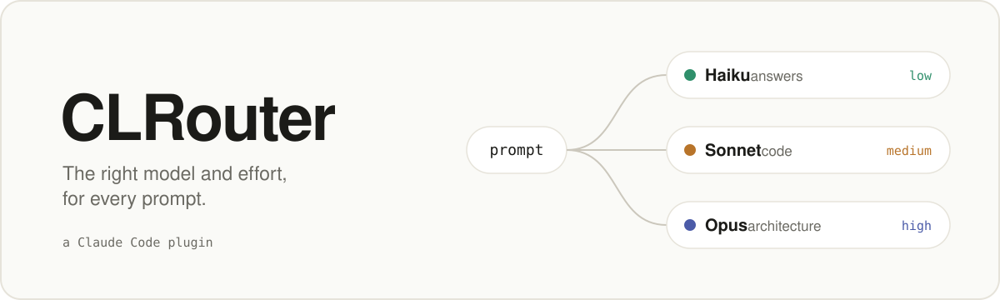

<picture>
  <source media="(prefers-color-scheme: dark)" srcset="assets/banner-dark.svg">
  
</picture>

<p align="center">
  <a href="#ติดตั้ง">ติดตั้ง</a> ·
  <a href="docs/how-it-works.md">ทำงานอย่างไร</a> ·
  <a href="bench">ผลวัด</a> ·
  <a href="README.md">English</a>
</p>

ใช้ Opus ที่ effort สูงกับทุก prompt คือค่าเริ่มต้นที่แพงที่สุด CLRouter เลือกโมเดลและ effort ให้ทีละ prompt ตามที่วัดมาแล้วว่าแต่ละตัวเก่งงานแบบไหน และถามคุณก่อนเปลี่ยนทุกครั้ง

```
 CLRouter
 Haiku fits this prompt (question or explanation). Run it on Haiku at low effort instead of Opus?

 ❯ 1. Use Haiku for this prompt
   2. Keep Opus
   3. Auto-route this session
   4. Turn off this session
```

## วัดจริง ไม่ได้เดา

สามชุดทดสอบ ทุกโมเดลถูกตรวจด้วยเทสต์ที่ไม่เคยเห็นมาก่อน:

| ชุดทดสอบ | Haiku | Sonnet | Opus |
| :-- | :-- | :-- | :-- |
| [เว็บคำนวณภาษีเงินได้](bench/thai-tax) เทสต์ลับ 20 ข้อ | 18, 19 จาก 20 · $0.07 | 20, 20 จาก 20 · $0.16 | 19 จาก 20 · $0.56 |
| [โจทย์ Exercism 30 ข้อ](bench/aider-polyglot) รอบที่สอง | 29 จาก 30 · $0.01 | 30 จาก 30 · $0.09 | 30 จาก 30 · $0.16 |
| [งานยากจาก SWE-bench 8 ข้อ](bench/swe-bench-hard) ตรวจด้วยตัวตรวจทางการ | 8 จาก 8 · $0.04 | 7 จาก 8 · $0.10 | 8 จาก 8 · $0.33 |

<sub>ราคาต่อโจทย์ หนึ่งหรือสองรอบต่อช่อง Effort: เว็บภาษี Haiku และ Sonnet ที่ medium, Opus ที่ high; Exercism ทุกตัวที่ medium; SWE-bench Haiku และ Opus ที่ high, Sonnet ที่ medium ทั้งสามชุดเป็น pilot และเทสต์ภาษีเขียนโดยผู้พัฒนาเอง จึงยังไม่มีชุดไหนผ่านเกณฑ์ใน[กติกาการวัด](bench/PROTOCOL.md)</sub>

- **Sonnet ตามหลัง Opus ไม่เกินหนึ่งข้อในทุกชุด** ที่ราคาราว 30 ถึง 60% ของ Opus งานโค้ดจึงไป Sonnet
- **Haiku ตามทันเมื่อมีอะไรบอกมันได้ว่าผิด** เช่น เทสต์ที่ล้ม หรือชุดเทสต์ของโปรเจกต์เอง ในเว็บภาษีที่ effort medium ซึ่งไม่มีอะไรตรวจมัน มันใช้กฎภาษีผิดทั้งสองรอบ ทั้งที่หน้าเว็บดูเสร็จสมบูรณ์ ที่ effort high มันทำถูกทั้งสองรอบ แต่ราคาเท่า Sonnet และช้ากว่าเกินสี่เท่า งานตอบคำถามจึงไป Haiku ส่วนกฎเรื่องเงินหรือกฎหมายไป Sonnet
- **ยังไม่รู้ว่า Opus คุ้มราคาตอนไหน** โจทย์ Exercism และบั๊กของ SWE-bench ง่ายเกินไปสำหรับโมเดลปัจจุบัน และโมเดลจำวิธีแก้สาธารณะได้: Opus เขียน patch ของผู้ดูแลโปรเจกต์ออกมาตรงทุกคำใน 2 ข้อของ SWE-bench จะตอบได้ต้องใช้โจทย์ที่ใหม่กว่าตัวโมเดล

## ติดตั้ง

พิมพ์ใน Claude Code:

```
/plugin install clrouter --marketplace thanyatornklin19/CLRouter
```

ใช้ได้ทั้งกับ API key และแผน Pro/Max

## ทำอะไรได้บ้าง

- **เลือกโมเดล**: ตอบคำถามไป Haiku, งานโค้ดและงานที่มีกฎตายตัวไป Sonnet, งานออกแบบระบบและตรวจความปลอดภัยไป Opus
- **เลือก effort**: งานตอบคำถามใช้ low, งานโค้ดใช้ medium, งานยากใช้ high และไม่ใช้ max เด็ดขาด
- **เปลี่ยนโมเดลเฉพาะตอนที่ถูกกว่าจริง** โดยคิดรวมค่า cache ที่ต้องสร้างใหม่ด้วย
- **จำคำตอบของคุณ**: ตอบตกลงสองครั้ง จะเลิกถาม ปฏิเสธสามครั้ง จะเลิกเสนอ
- **กู้คืนเมื่อพลาด**: ถ้าคุณแย้งคำตอบของโมเดลถูก ("ผิด", "ยังไม่ได้") ข้อความนั้นจะไปรันบนโมเดลของคุณเอง ถ้ากดหยุดกลางคัน `/clrouter redo` จะส่ง prompt เดิมไปที่นั่นอีกครั้ง ทุกครั้งที่พลาดจะนับเป็นคะแนนลบของการสลับแบบนั้น
- **บอกว่าประหยัดไปเท่าไร** ทั้งเป็นเงิน และเป็นโควตา 5 ชั่วโมงที่ใช้ไป:

```
› /clrouter stats
CLRouter, last 7 days: 212 turns.
- Sent to another model: 64 (Haiku 51, Sonnet 13). Effort only: 98. Left alone: 50.
- Those turns cost $0.41. On your session's model they'd have cost at least $2.90: saved at least $2.49.
- Five-hour window used per turn: Haiku 0.1%, Sonnet 0.8%, Opus 2.3%.
```

<sub>เป็นตัวอย่างเท่านั้น ตัวเลขจริงมาจากการใช้งานของคุณเอง</sub>

## คำสั่ง

| คำสั่ง | ทำอะไร |
| :-- | :-- |
| `/clrouter` | แสดงโหมด สิ่งที่จำไว้ และการตัดสินใจครั้งล่าสุด |
| `/clrouter stats [วัน]` | แสดงค่าใช้จ่าย เงินที่ประหยัด และโควตา 5 ชั่วโมง |
| `/clrouter redo [โมเดล]` | ใส่ prompt ล่าสุดที่ถูกสลับโมเดลกลับลงช่องพิมพ์ เพื่อรันบนโมเดลของคุณหรือโมเดลที่ระบุ |
| `/clrouter doctor` | ตรวจการตั้งค่า: เวอร์ชัน Claude Code, model id, ราคา และการอ่านโควตา 5 ชั่วโมง |
| `/clrouter test <ข้อความ>` | บอกว่า prompt นี้จะได้โมเดลและ effort อะไร พร้อมเหตุผล |
| `/clrouter ask \| auto \| suggest \| off` | ตั้งโหมดสำหรับ session นี้ |
| `/clrouter forget` | ล้างคำตอบที่จำไว้ |
| `/clrouter collect on` · `export` | เก็บ prompt ไว้ในเครื่องคุณ แล้วเขียนออกเป็นไฟล์ให้ติดป้ายได้ |
| `/clrouter:dev <งาน>` | เขียนเทสต์แล้วล็อกไว้ จากนั้นให้โมเดลถูกที่สุดที่ทำผ่านเป็นคนเขียนโค้ด (ทดลอง) |

## ควรใช้ไหม

ใช้ได้ในฐานะเบต้า ด้วยโหมด `ask` ที่เป็นค่าเริ่มต้น: ไม่มีอะไรเปลี่ยนถ้าคุณไม่กด

1. ติดตั้ง แล้วใช้โหมด `ask` ไปหนึ่งสัปดาห์
2. ดู `/clrouter stats` ว่าประหยัดไปเท่าไร คุณปฏิเสธบ่อยแค่ไหน และการสลับโมเดลพลาดบ่อยแค่ไหน
3. ถ้าแทบไม่ปฏิเสธและแทบไม่พลาด เปลี่ยนเป็น `/clrouter auto`

งานออกแบบระบบหรือบั๊กที่ข้ามหลาย service ให้เลือก Opus เอง และถ้ายอมให้ Haiku เขียนโค้ด ควรมีเทสต์ไว้ ถ้าต้องการตัวเลขค่าใช้จ่ายหรือคุณภาพที่รับประกันได้สำหรับทีม ให้รอก่อน ตอนนี้ยังไม่มีอะไรผ่านเกณฑ์นั้น

## ควรรู้

- **ยังเป็นเบต้า** สร้างบน plugin API ของ Claude Code ที่ยังเป็น early access ซึ่งอาจเปลี่ยนได้ ทดสอบแล้วบน Claude Code 2.1.287 (stable) ถึง 2.1.296 (latest) และ [CI](.github/workflows/ci.yml) ตรวจซ้ำทั้งสองช่องทางทุกวัน ถ้าใช้เวอร์ชันอื่นจะแจ้งหนึ่งครั้ง และ `/clrouter doctor` จะบอกว่ามันเห็นอะไร
- **ความแม่น**: กับ prompt ที่ไม่ได้ใช้ปรับมาก่อน เลือกถูก 14 จาก 20 ครั้ง และไม่เคยส่งงานโค้ดหรืองานที่มีกฎตายตัวไป Haiku
- **ตัวเลขประหยัดเป็นค่าขั้นต่ำ** ไม่บอกเกินจริง และถ้าขาดทุนจะบอกว่าขาดทุน
- **`/clrouter:dev` ยังเป็นการทดลอง** บั๊กที่ขั้นตอนยาวๆ ไปจบบนโมเดลของ session แก้แล้วใน hook และมีเทสต์ครอบ แต่ยังไม่ได้เห็นในการรันจริง
- **ยังไม่ได้วัด**: การเลือกงานระดับ Opus, การประหยัดในการใช้งานจริง และการอ่านโควตา 5 ชั่วโมงบนบัญชี Pro จริง ถ้าใช้แผน Pro หรือ Max คำสั่ง `/clrouter doctor` ตอบข้อสุดท้ายได้ใน 5 วินาที

## ช่วยให้ดีขึ้น

สิ่งที่มีประโยชน์ที่สุดคือ prompt: prompt จริงจากงานของคุณ พร้อมบอกว่าอยากให้ใช้โมเดลไหน `/clrouter collect on` เก็บไว้ในเครื่องคุณ ผ่านไปสักสัปดาห์ `/clrouter export` จะเขียนออกเป็นไฟล์ที่มีช่อง `want` ว่างไว้ทุกบรรทัด กรอกให้ครบ ลบสิ่งที่เป็นข้อมูลส่วนตัว แล้วแนบมาใน issue วิธีนี้วัด router ได้กับงานที่ไม่ได้ใช้สร้างมันขึ้นมา [เปิด issue →](https://github.com/thanyatornklin19/CLRouter/issues)

<sub>[ทำงานอย่างไร](docs/how-it-works.md) · [ผลวัด](bench) · MIT</sub>
